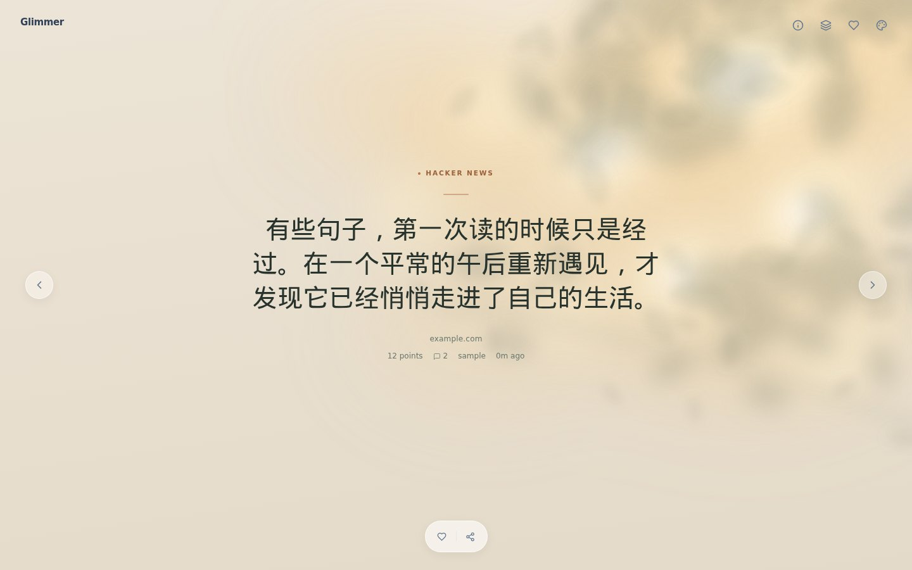
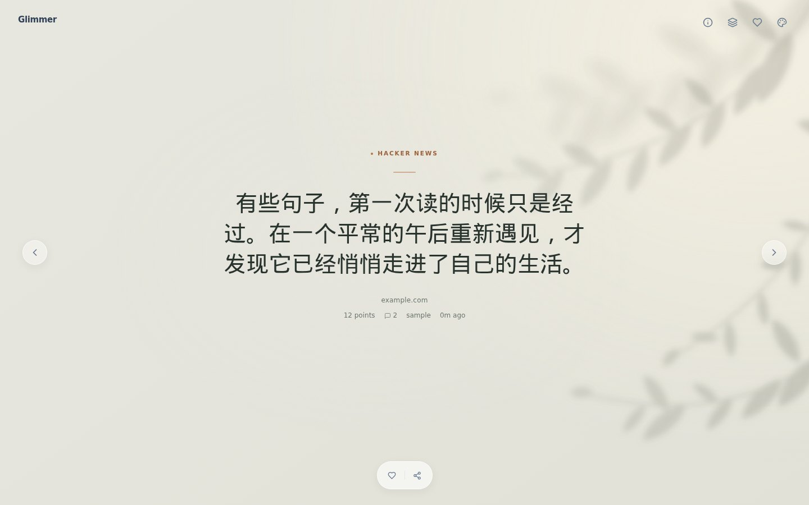
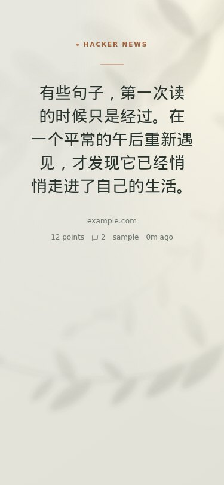

# Dapple quality pass

## Plan

The baseline at 617ffc7 combines three blurred light layers with two overlapping shadow layers. Their yellow and grey overlap reads as stains, and the leaves lose their shape. Remove the independent light spots. Project one connected canopy onto a quiet neutral ivory wall, keep two shadow depths, and reserve open space for reading. Drive the projection and twig bends with one breeze cycle. Check the actual extension and the hosted preview, not only a static composition.

## Iteration record

1. Rebuilt the canopy as attached leaf silhouettes. Cleaner, but evenly paired leaves looked like a decorative fern. Rejected that regularity.
2. Curved the twigs, reduced the leaf count, varied spacing, angles and lengths deterministically. Kept the neutral wall over the old yellow plaster.
3. Adjusted the starting phase of the shared 12-second breeze so a newly opened tab shows movement within its first four seconds instead of starting near a turning point. Kept the amplitude restrained.

## Verified

- Loaded the built unpacked extension in Chrome, with a synthetic reading item and the Dapple setting. Same sample and viewport used for the baseline extension.
- Inspected baseline and final side by side, desktop and 375px. The final has more open wall, distinct leaf silhouettes and no overlapping yellow spots. It is cleaner; it remains an abstract projection rather than photographic foliage.
- Captured actual extension frames four seconds apart. Average pixel difference is 1.65 levels out of 255 versus 0.60 for the baseline under the same capture procedure. This measures frame change, not perceived quality. Text stays still.
- The reduced-motion extension has zero animations and identical screenshots 1.5 seconds apart. No horizontal overflow at 375px.
- Hosted private preview checked at 320, 375, 390 and 1280px. Theme selection, Animate toggle, and reduced-motion CSS checked. Six animation tracks represent one canopy breeze, three child twig bends, a distant projection and daylight intensity. Pause freezes all six.
- Lint, 84 tests, web build, extension build and regression checks pass.

## Evidence

No changes to other themes, no theme removals, and no merge to main.
