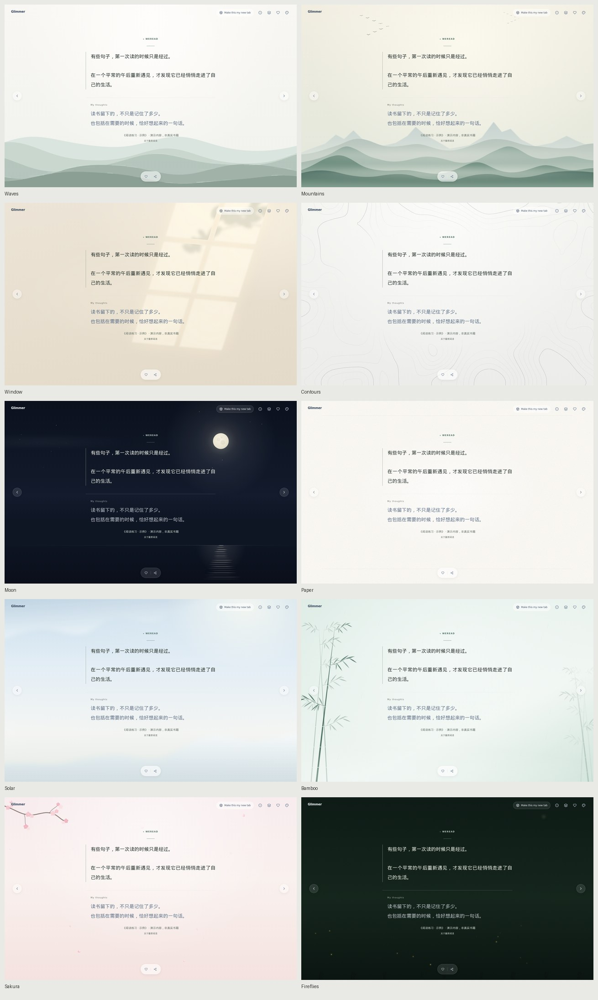
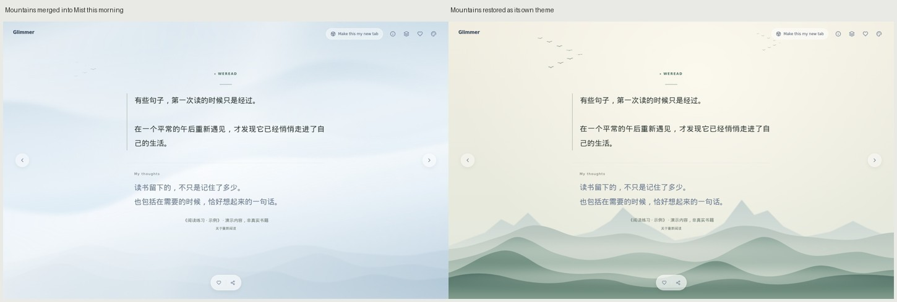
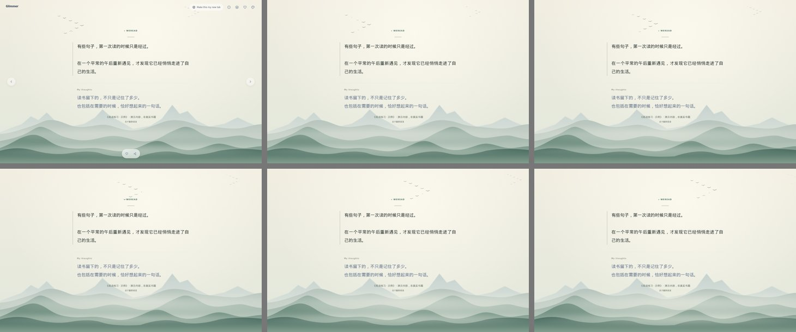
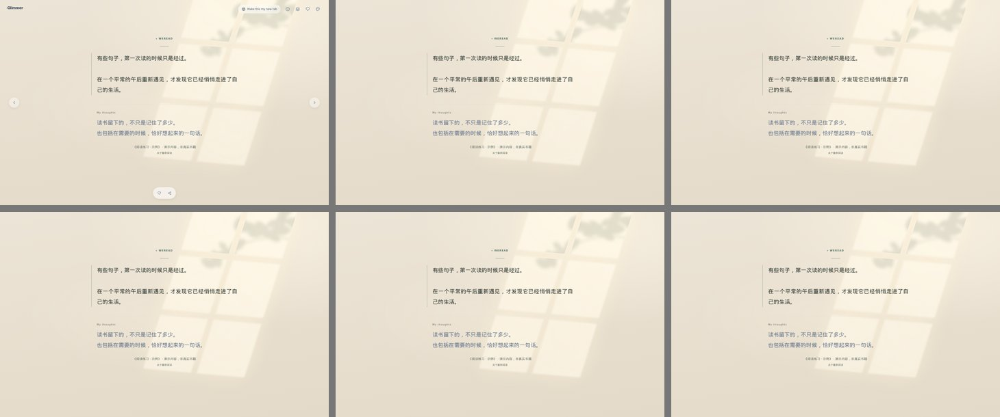
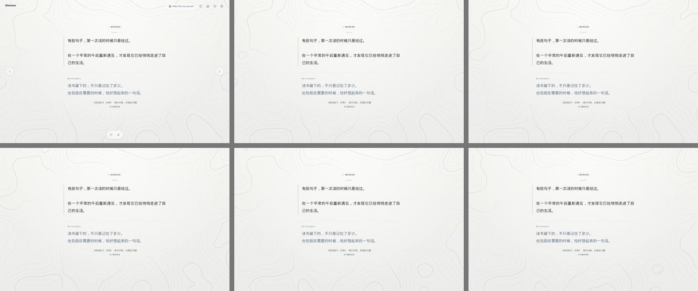
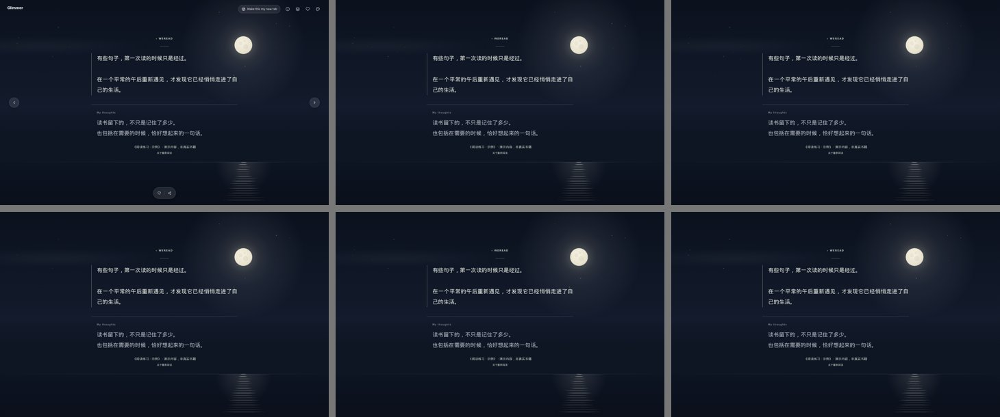
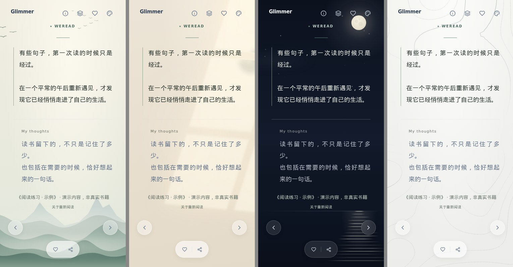
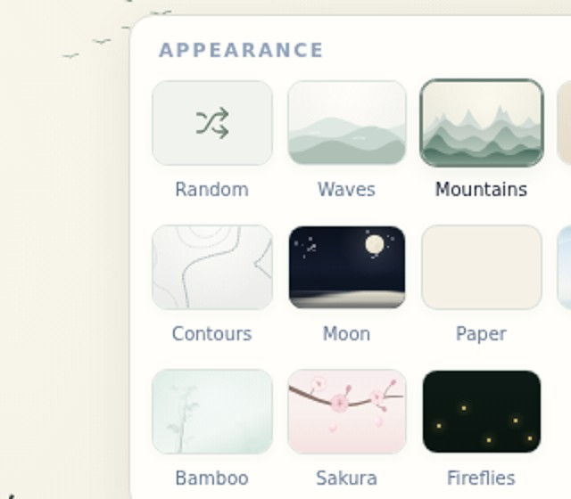

# Theme expansion review

Rendered from `dev/theme-expansion`, branched from `dev/theme-redesign` at `c6df83a`. Actual browser renders at 1440 x 900 with the same fictional reading sample, not mockups. Each image is one animation frame.

## Mountains, kept as its own theme

## New themes

- [Window](window.jpg)
- [Contours](contours.jpg)
- [Moon](moon.jpg)

## Kept

- [Waves](waves.jpg), [Mountains](mountains.jpg), [Paper](paper.jpg), [Solar](solar.jpg), [Bamboo](bamboo.jpg), [Sakura](sakura.jpg), [Fireflies](fireflies.jpg)

## Motion, frames 5 seconds apart

## Narrow screen, 375 px wide

Mountains, Window, Moon, Contours in that order.

## Picker

