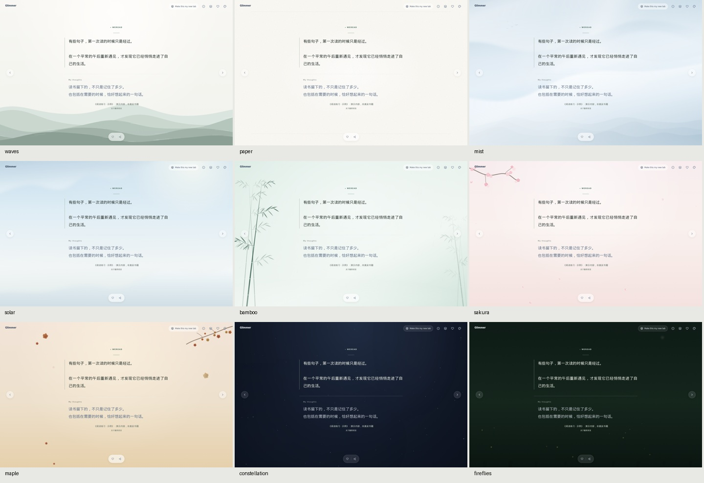
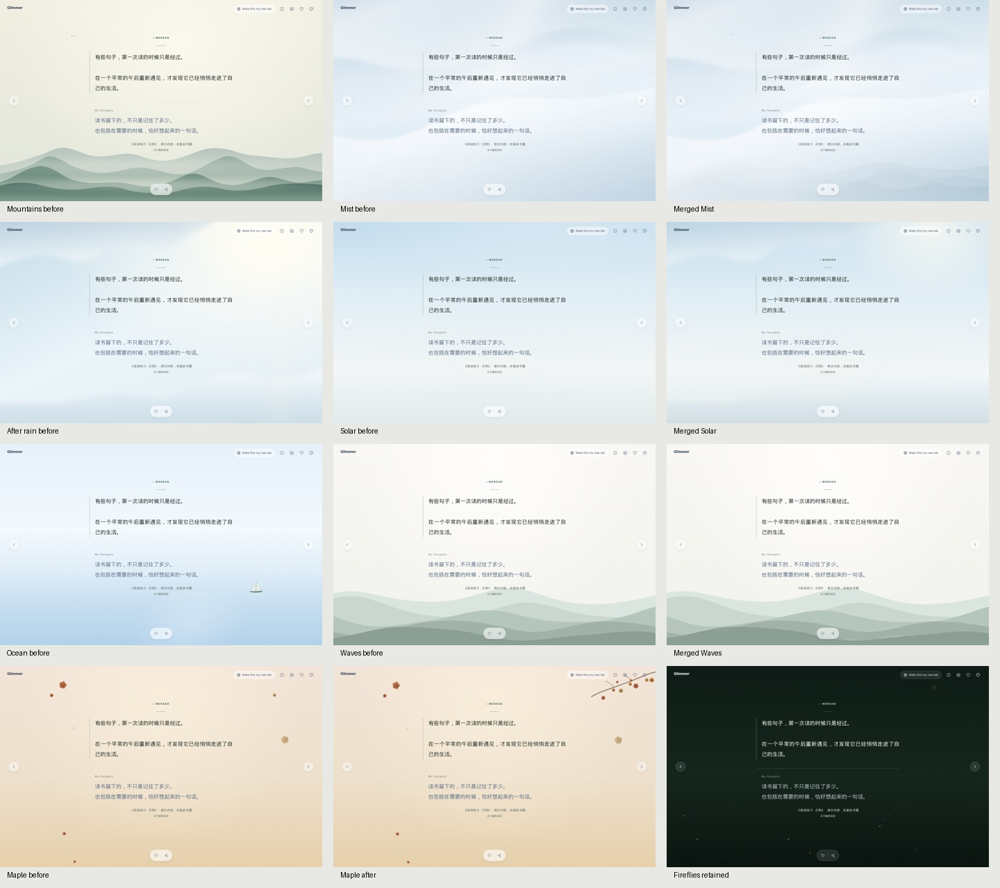

# Theme redesign review

Rendered from `dev/theme-redesign`, code commit `f6ec750f3a47a5fe860b2e87af3f3e9b6ae09eba`.

These are actual browser renders with the same fictional reading sample, not mockups or user reading data. Desktop captures are 1440 × 900. Each image captures one animation frame; Solar shows one local-light phase, not its full daily cycle.

## Nine-theme result

## Merge and Maple comparisons

Rows 1-3: original donor, original receiving theme, merged result. Row 4: Maple before, Maple after, retained Fireflies. Before renders use base commit `31c62938c1a773c8bb134bc616a5dd072bc07351`.

## Individual screens

- [Waves](waves.jpg)
- [Paper](paper.jpg)
- [Mist](mist.jpg)
- [Solar](solar.jpg)
- [Bamboo](bamboo.jpg)
- [Sakura](sakura.jpg)
- [Maple](maple.jpg)
- [Stars](constellation.jpg)
- [Fireflies](fireflies.jpg)
